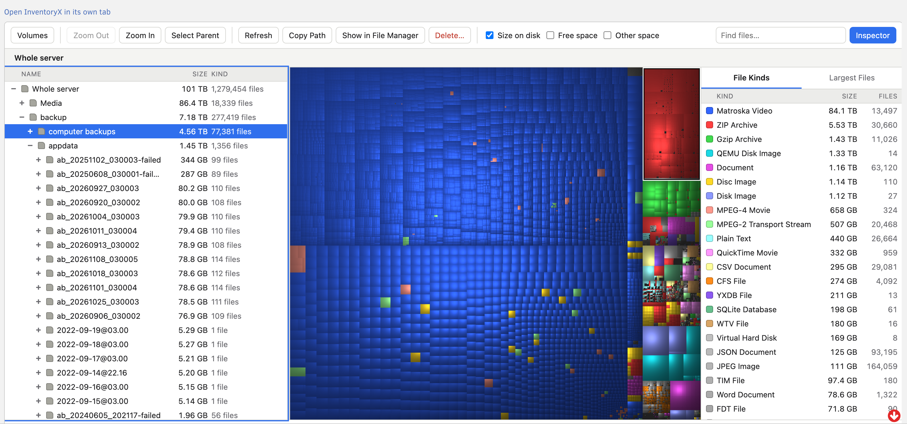
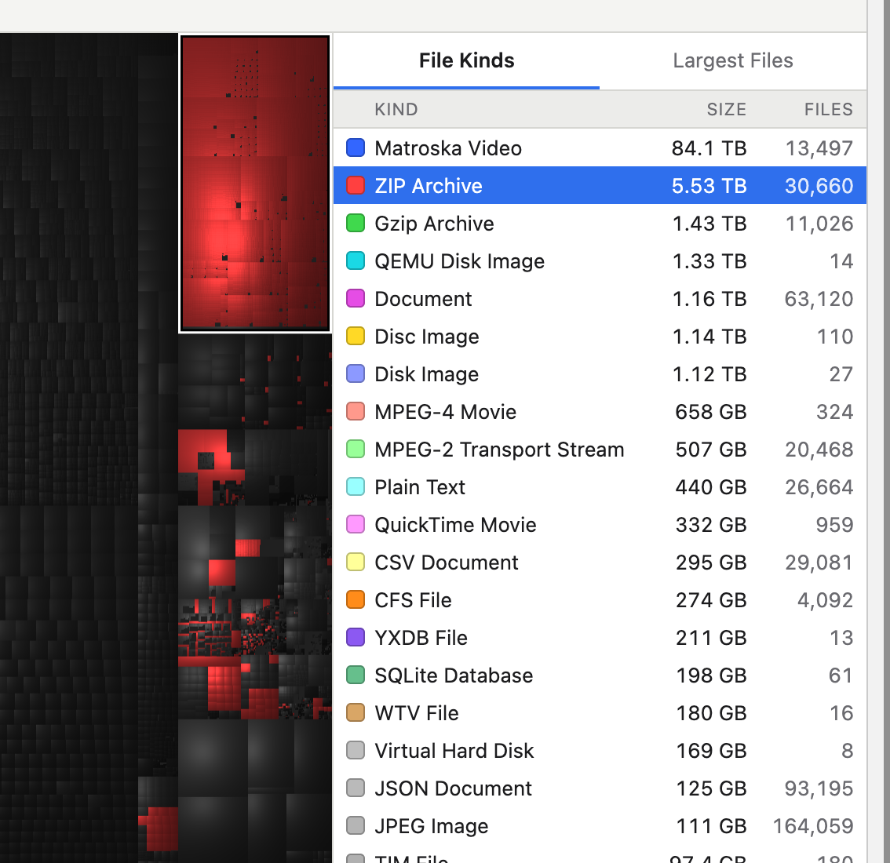
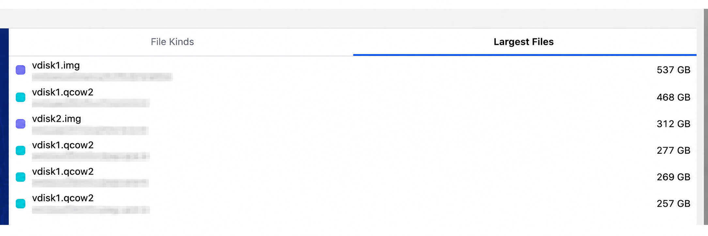
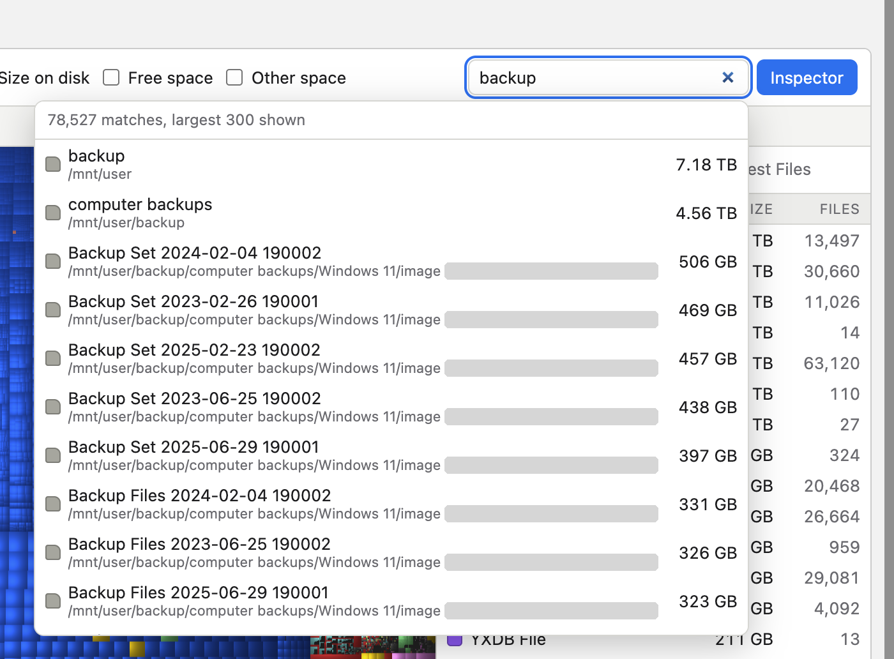
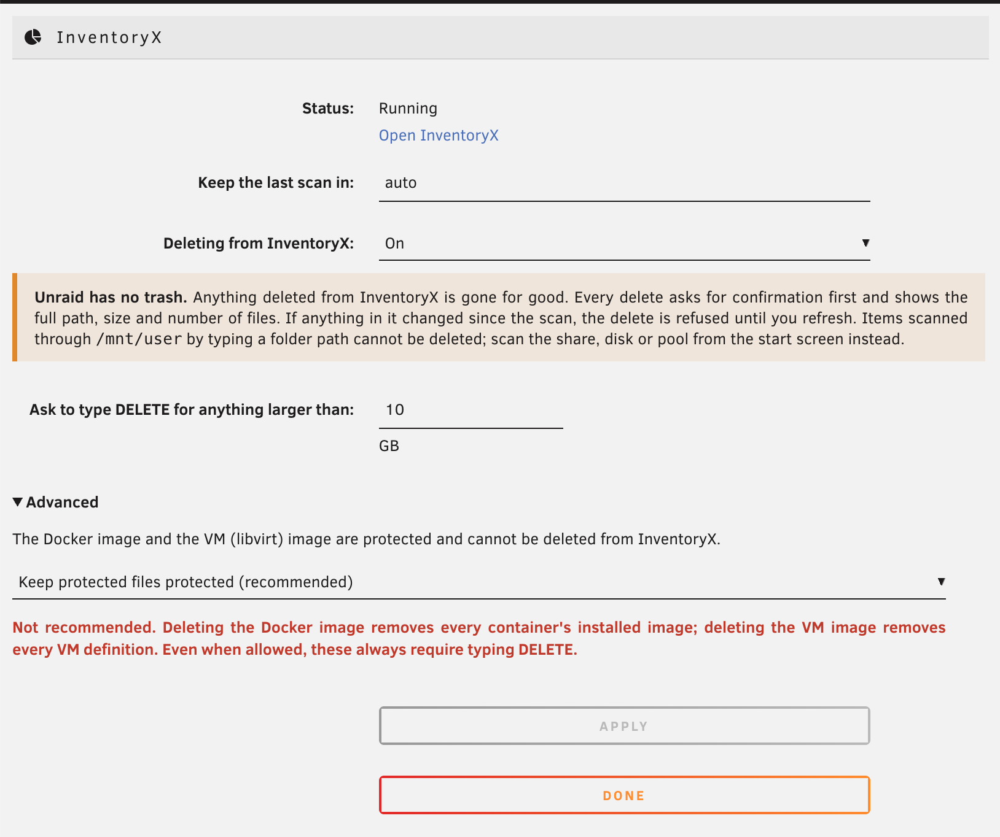

# InventoryX

See what is using your disk space on Unraid.

InventoryX scans your array, pools and shares and shows the result as a treemap: every file
is a rectangle sized by the space it takes and coloured by its kind, so the big things are
impossible to miss. It is a port of [Disk Inventory X](https://www.derlien.com/) for macOS
to Linux, packaged as an Unraid plugin.



## What it does

- **Scan** the whole server, the array, a single disk, a pool, a share or any folder. Shares
  are read from the underlying disks directly, which is much faster than going through
  `/mnt/user`.
- **Treemap and file list** side by side. Click either one and the other follows.
- **Zoom** into any folder; breadcrumbs take you back out.
- **File kinds** by total size. Click a kind to highlight its files in the map.
- **Largest files**: the 200 biggest in the current view.
- **Search** by name across the whole scan as you type.
- **Progress with time remaining** for whole-disk scans. Scans run on the server, so you can
  close the page and come back later.
- **Saved scans**: the last scan is kept on a pool and is there straight away after a reboot.
- **Delete**, off by default, with guards (see below).

Hard links are counted once, other filesystems are not entered, and totals match `du`.

**ZFS is untested.** InventoryX was built and tested on XFS array disks and a btrfs pool. It
is written to scan ZFS pools too (child datasets are included, snapshots are skipped), but
that has never been run on a real ZFS pool. Sizes and free space may be wrong there, and
InventoryX says so on any scan that includes ZFS. Reports are welcome.

## How you use it

Open **Tools → InventoryX**, pick what to scan, and you get three panes: the file tree on the
left, the treemap in the middle and the file kinds on the right. Selecting something in one
pane selects it in the others. Right-click a row or a block for Zoom In, Select Parent,
Copy Path, Show in File Manager and Delete.

**Highlight a kind.** Click a kind in the list and everything else in the map goes dark, so
you can see where those files are.



**Largest files.** The second tab lists the biggest files in the current view with their
paths (blurred in this picture).



**Search.** Type part of a name; matches from the whole scan appear largest first, each with
its folder.



**Settings.** Under **Settings → User Utilities → InventoryX** you choose where the last scan
is kept and whether deleting is allowed.



## Install

In the Unraid web UI: **Plugins → Install Plugin**, paste this URL and press Install.

```
https://raw.githubusercontent.com/DanITman/inventoryx/main/inventoryx.plg
```

Then open **Tools → InventoryX**. Settings are under **Settings → User Utilities → InventoryX**.

Requires Unraid 7.0 or later on x86-64.

## Deleting

Unraid has no trash, so anything deleted from InventoryX is gone for good. Deleting is
**off** until you turn it on in the settings. When it is on:

- The flash drive, the operating system, disks, pools, mount points and anything containing
  a mounted filesystem can never be deleted.
- The Docker image and the VM (libvirt) image are protected. An advanced setting can unlock
  them; it is not recommended.
- Whole shares, protected items and anything larger than 10 GB (configurable) require
  typing `DELETE`.
- Every delete shows the full path, size and number of files first.
- If a file or folder has changed since it was scanned, the delete is refused until you
  refresh, so you never delete something you have not seen.

These rules are enforced by the program on the server, not by the web page.

## How it works

One small static program (Rust) runs on the server and does the scanning, layout and
search. It listens on a Unix socket only. The web UI reaches it through a PHP page inside
Unraid's own web server, so Unraid's login and request-forgery protection apply and no extra
network port is opened.

## Build from source

Needs [rustup](https://rustup.rs) with the `x86_64-unknown-linux-musl` target.

```sh
cargo test                 # run the tests
./scripts/build.sh         # static Linux binary
./scripts/package.sh       # dist/inventoryx-VERSION.tgz and inventoryx.plg
```

For development on any Unix machine: `cargo run -- serve` and open `http://127.0.0.1:7878`.

## Credits and license

InventoryX is a port of Disk Inventory X by Tjark Derlien, and keeps its look: a squarified
cushion treemap (Bruls, Huizing and van Wijk; van Wijk and van de Wetering).

GNU General Public License v3 or later. See [LICENSE](LICENSE).
